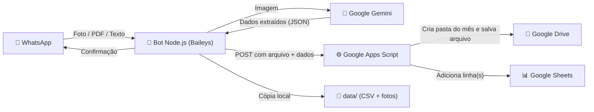
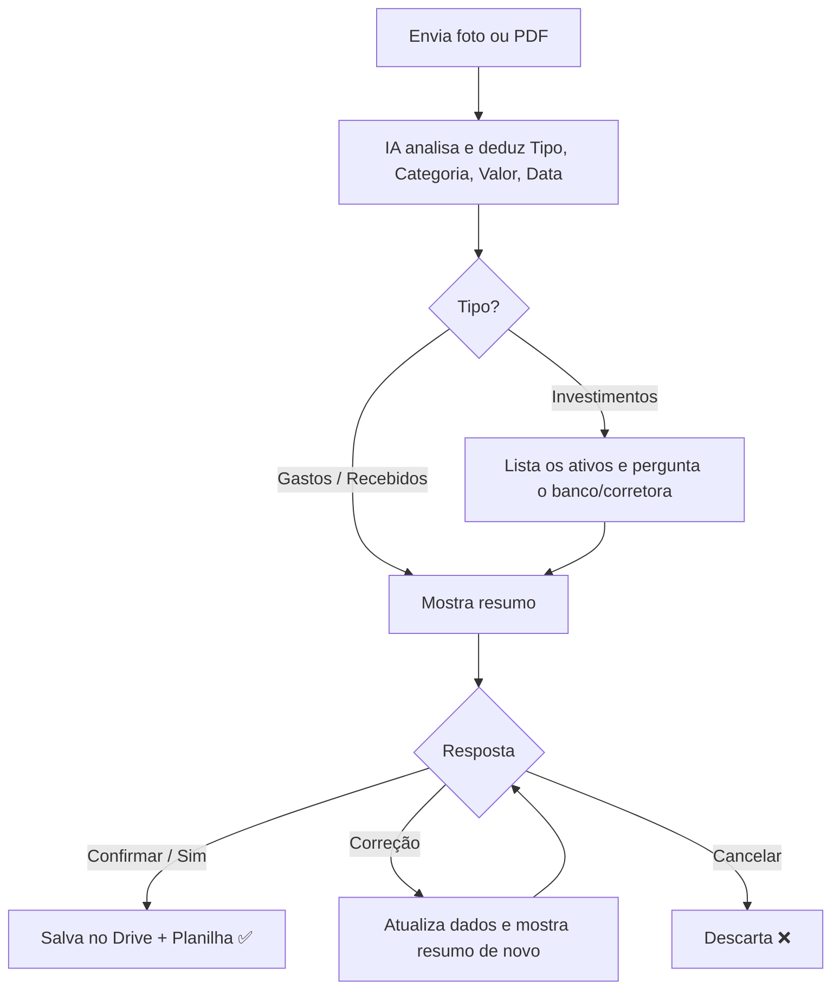

# 🤖 WhatsApp Bot de Comprovantes — Controle Financeiro Pessoal com IA

Bot pessoal de WhatsApp em **Node.js** que recebe fotos e PDFs de comprovantes, notas fiscais e prints de investimentos. Ele lê os dados com **Google Gemini (IA)**, organiza os arquivos em **pastas mensais no Google Drive** e registra tudo em uma planilha do **Google Sheets**, além de manter um backup local compatível com Excel.

Sem API paga do WhatsApp e sem configurar OAuth no Google Cloud: a conexão com o WhatsApp é feita via **QR Code** e a gravação no Drive/Sheets é feita por um **Google Apps Script** que roda na sua própria conta.

---

## 📑 Sumário

- [Funcionalidades](#-funcionalidades)
- [Como funciona (arquitetura)](#-como-funciona-arquitetura)
- [Fluxos de conversa](#-fluxos-de-conversa)
- [Organização no Google Drive](#-organização-no-google-drive)
- [Estrutura da planilha](#-estrutura-da-planilha)
- [Requisitos](#-requisitos)
- [Instalação e configuração](#-instalação-e-configuração)
- [Variáveis de ambiente (.env)](#-variáveis-de-ambiente-env)
- [Comandos disponíveis](#-comandos-disponíveis)
- [Estrutura do projeto](#-estrutura-do-projeto)
- [Backup local](#-backup-local)
- [Solução de problemas](#-solução-de-problemas)
- [Cota gratuita do Gemini](#-cota-gratuita-do-gemini)
- [Segurança e privacidade](#-segurança-e-privacidade)
- [Limitações conhecidas](#-limitações-conhecidas)

---

## ✨ Funcionalidades

### 🧠 Leitura inteligente com IA
- Lê **fotos (JPG/PNG) e PDFs** enviados no WhatsApp.
- Identifica se a imagem é realmente um comprovante, cupom, nota fiscal ou investimento.
- Extrai **valor, data e hora do pagamento, meio de pagamento, banco/instituição e ID da transação**.

### 🏷️ Dedução automática de Tipo e Categoria
- **Tipo do lançamento:**
  - **Recebidos:** Pix/transferência/depósito recebido, ou quando o titular aparece como destinatário.
  - **Gastos:** compras, Pix enviados, boletos pagos, cupons e notas fiscais.
  - **Investimentos:** CDB, LCI/LCA, Tesouro Direto, fundos, ações, FIIs, caixinhas, cripto, telas de carteira.
- **Categoria (deduzida pelo tipo de estabelecimento):**

  | Categoria | Exemplos de estabelecimento |
  | :--- | :--- |
  | **Alimentação** | Restaurantes, padarias, mercados, lanchonetes, iFood, cafés, pizzarias |
  | **Transporte** | Postos de combustível, Uber, 99, estacionamento, pedágio, oficina, passagens |
  | **Matéria-prima** | Insumos, embalagens, gráfica, tecidos, fornecedores de materiais |
  | **Outros** | Demais casos (serviços, saúde, vestuário, eventos, etc.) |

### 📈 Investimentos
- Lê prints com **vários investimentos de uma vez** (ex.: `CDB 200%`, `Fundos XP Advisory`, `NTN-B Tesouro`), cada um com seu valor.
- **Sempre pergunta em qual banco ou corretora** o investimento está sendo depositado.
- Ao confirmar, a imagem é salva **uma única vez** no Drive e **cada ativo vira uma linha** na planilha.

### 👤 Pagador somente em Recebidos
- Por ser um bot pessoal, **não registra** quem enviou a mensagem no WhatsApp nem o recebedor.
- O campo **Pagador** só é preenchido em lançamentos **Recebidos** (quem enviou o dinheiro para você).

### 💬 Confirmação antes de salvar
- O bot **nunca salva direto**: mostra o resumo e espera você confirmar.
- Você pode corrigir qualquer dado em linguagem natural antes de salvar.

### 📁 Pastas mensais pela data do pagamento
- O comprovante vai para a pasta do **mês em que foi pago**, não do mês em que foi enviado.
- Se a pasta do mês não existir, ela é **criada automaticamente**.

---

## 🏗️ Como funciona (arquitetura)



1. O bot conecta ao WhatsApp como um **aparelho conectado** (via QR Code).
2. Ao receber uma mídia, envia a imagem para o **Gemini**, que devolve os dados estruturados.
3. O bot mostra o resumo e aguarda sua confirmação.
4. Ao confirmar, envia o arquivo e os dados para o **Apps Script** da sua planilha, que salva no Drive e no Sheets usando **a sua própria conta Google**.

---

## 💬 Fluxos de conversa

### 1. Enviando foto/PDF direto (recomendado)



**Exemplo — Gasto:**
```
Você: [foto do cupom]
Bot:  🤖 Comprovante Analisado pela IA:
      📂 Tipo: Gastos
      🏷️ Categoria: Alimentação
      💳 Meio: Cartão de crédito
      💰 Valor: R$ 26,90
      📅 Data do Pagamento: 23/03/2026
      📁 Pasta no Drive: 2026-03 (Março)
      👉 Digite Confirmar para salvar...
Você: Confirmar
Bot:  Registrado com sucesso ✅
```

**Exemplo — Investimentos:**
```
Você: [print da carteira]
Bot:  📈 Investimento(s) Identificado(s) pela IA:
      1. CDB 200% (Renda Fixa) — R$ 100.000,00
      2. Fundos XP Advisory (Fundos de investimento) — R$ 20.000,00
      3. NTN-B Tesouro (Tesouro Direto) — R$ 30.000,92
      💰 Total: R$ 150.000,92
      🏦 Em qual banco ou corretora está sendo depositado este investimento?
Você: XP
Bot:  🤖 Resumo do(s) Investimento(s): ... Digite Confirmar para salvar todos os itens
Você: Sim
Bot:  Registrado com sucesso ✅ (3 linhas na planilha)
```

### 2. Corrigindo dados antes de salvar

Na etapa de confirmação, você pode responder:

| Você digita | O que acontece |
| :--- | :--- |
| `Confirmar`, `Sim`, `Ok`, `Pode salvar` | Salva o registro |
| `Cancelar`, `Não` | Descarta o registro |
| `26.90` ou `R$ 26,90` | Troca o valor e salva *(apenas quando há 1 item)* |
| `muda a categoria para Transporte` | Corrige a categoria |
| `é Recebidos` / `foi investimento` | Corrige o tipo |
| `data 15/03/2026` | Corrige a data (e a pasta do mês) |
| `pagador: João` | Define quem enviou o valor *(só em Recebidos)* |
| `muda o banco para BTG` | Corrige a instituição |
| `muda o CDB para 90000` | Corrige o valor de um investimento específico |

> Quando há **vários investimentos**, digitar só um número não é aceito como atalho, porque não daria para saber qual item alterar. Diga qual item quer mudar.

### 3. Registro manual com `/start` (com ou sem foto)

```
/start
→ O que deseja registrar?  1 - Recebidos | 2 - Gastos | 3 - Investimentos
→ Envie a foto da nota/comprovante (ou 0 para continuar sem foto)
```

Enviando **foto**, o bot segue o fluxo da IA mantendo o tipo que você escolheu. Enviando **`0` (sem foto)**:

| Gastos / Recebidos | Investimentos |
| :--- | :--- |
| Categoria (1 a 4) | Banco / corretora |
| Meio de pagamento (1 a 5) | Ativo (ex.: CDB, Tesouro) |
| Valor | Valor investido |
| Pagador *(só Recebidos, `0` pula)* | — |
| Data (`0` = hoje ou `DD/MM/AAAA`) | Data (`0` = hoje ou `DD/MM/AAAA`) |

**Meios de pagamento:** `1` Transferência · `2` Pix · `3` Cartão de crédito · `4` Cartão de débito · `5` Cédula

---

## 📁 Organização no Google Drive

Dentro da pasta principal configurada, o bot cria uma subpasta por mês, no formato `AAAA-MM (Mês)`:

```
📁 Comprovantes (pasta principal)
├── 📁 2026-03 (Março)
│   ├── Gastos_Alimentacao_2026-03-23_19-25-00_R_26_90.jpg
│   └── Investimentos_XP_2026-03-10_10-12-44_R_150_000_92.png
├── 📁 2026-10 (Outubro)
└── 📁 2026-11 (Novembro)
```

- O mês vem da **data do pagamento** do comprovante. Um comprovante de **23/03** enviado em novembro vai para **2026-03 (Março)**.
- Se o comprovante não tiver data legível, usa a data atual (e você pode corrigir antes de salvar).
- Nome do arquivo: `Tipo_Categoria_Data_Hora_Valor.ext`. Em investimentos, usa o banco no lugar da categoria.
- Registros **sem foto** não criam arquivo no Drive; vão apenas para a planilha.

---

## 📊 Estrutura da planilha

Os registros são gravados na aba definida em `GOOGLE_SHEETS_TAB` (padrão: `Comprovantes`). A aba e o cabeçalho são criados automaticamente.

| Coluna | Descrição | Exemplo |
| :--- | :--- | :--- |
| **Mês Competência** | Mês/ano do pagamento | `03/2026` |
| **Data do Pagamento** | Data real da transação | `23/03/2026` |
| **Hora do Pagamento** | Hora, se existir no comprovante | `19:25` |
| **Tipo** | Recebidos, Gastos ou Investimentos | `Gastos` |
| **Categoria** | Categoria ou ativo do investimento | `Alimentação` / `CDB 200% (Renda Fixa)` |
| **Meio de Pagamento** | Pix, cartão, transferência, aplicação... | `Cartão de crédito` |
| **Valor (R$)** | Valor numérico | `26.9` |
| **Pagador (Recebidos)** | Quem enviou o valor (só Recebidos) | `Fulano de Tal` |
| **Banco / Instituição** | Banco ou corretora | `XP` |
| **ID / Autenticação** | E2E do Pix, autenticação, chave de acesso | `E1234...` |
| **Data/Hora Registro** | Quando foi lançado pelo bot | `09/11/2026 00:50:12` |
| **Link do Comprovante** | Link do arquivo no Drive | `https://drive.google.com/...` |

> Em investimentos com vários ativos, cada ativo gera **uma linha**, todas com o mesmo link de comprovante.

---

## 📋 Requisitos

- **Node.js 18+** (recomendado LTS), porque o bot usa o `fetch` nativo.
- Uma conta **WhatsApp** no celular (para escanear o QR Code).
- Uma conta **Google** com uma pasta no Drive e uma planilha no Sheets.
- Uma **chave de API do Gemini** (gratuita no Google AI Studio).
- **Git** instalado (necessário para baixar uma dependência do Baileys durante o `npm install`).

---

## 🚀 Instalação e configuração

### 1. Clonar e instalar dependências

```bash
git clone <url-do-seu-repositorio>
cd whatsappbot
npm install
```

> No Windows, se o `npm install` falhar ao rodar scripts de pós-instalação, use `npm install --ignore-scripts`.

### 2. Criar a chave do Gemini

1. Acesse o [Google AI Studio](https://aistudio.google.com/app/apikey).
2. Clique em **Create API key** e copie a chave.

### 3. Preparar Drive e Planilha

1. Crie (ou escolha) uma **pasta** no Google Drive. O ID é a parte final da URL:
   `https://drive.google.com/drive/folders/`**`ESTE_E_O_ID`**
2. Crie (ou escolha) uma **planilha** no Google Sheets. O ID fica no meio da URL:
   `https://docs.google.com/spreadsheets/d/`**`ESTE_E_O_ID`**`/edit`

### 4. Publicar o Google Apps Script

1. Na planilha, abra **Extensões → Apps Script**.
2. Apague o código existente, cole todo o conteúdo de [`google-apps-script.js`](google-apps-script.js) e salve (**Ctrl + S**).
3. No topo do editor, selecione a função **`autorizarPermissoes`** e clique em **▷ Executar**.
   - Clique em **Revisar permissões** e escolha sua conta.
   - Se aparecer *"O Google não verificou este app"*, clique em **Avançado → Acessar (não seguro) → Permitir**. O aviso aparece porque o script é seu e não passou por verificação pública.
4. Clique em **Implantar → Nova implantação**:
   - Tipo: **App da Web**
   - Executar como: **Eu**
   - Quem pode acessar: **Qualquer pessoa** *(e não "Qualquer pessoa com conta do Google")*
5. Clique em **Implantar** e copie a **URL do app da Web** (termina em `/exec`).

> **Atualizando o script depois:** use **Implantar → Gerenciar implantações → ✏️ Editar → Versão: Nova versão → Implantar**. Assim a URL continua a mesma. Se você só salvar o código sem criar nova versão, o Google continua rodando o código antigo.

### 5. Configurar o `.env`

```powershell
Copy-Item .env.example .env
```

Preencha os valores (veja a [tabela abaixo](#-variáveis-de-ambiente-env)).

### 6. Iniciar o bot

```bash
npm start
```

No Windows, você também pode dar dois cliques em [`iniciar-bot.bat`](iniciar-bot.bat).

Na primeira execução, um **QR Code** aparece no terminal. No celular, abra **WhatsApp → Aparelhos conectados → Conectar um aparelho** e escaneie. A sessão fica salva em `auth_info_baileys/`, então nas próximas vezes não precisa escanear de novo.

---

## ⚙️ Variáveis de ambiente (.env)

| Variável | Obrigatória | Padrão | Descrição |
| :--- | :---: | :--- | :--- |
| `GEMINI_API_KEY` | ✅ | — | Chave da API do Gemini |
| `GEMINI_MODEL` | | `gemini-2.5-flash,gemini-2.5-flash-lite` | Modelos do Gemini em ordem de preferência, separados por vírgula. Se um estourar a cota, o próximo é usado |
| `GOOGLE_DRIVE_FOLDER_ID` | ✅ | — | ID da pasta principal no Drive |
| `GOOGLE_SHEETS_ID` | ✅ | — | ID da planilha |
| `GOOGLE_SHEETS_TAB` | | `Comprovantes` | Nome da aba onde os dados são gravados |
| `GOOGLE_APPS_SCRIPT_URL` | ✅* | — | URL `/exec` do Apps Script publicado |
| `ONLY_RECEIPTS` | | `true` | Se `true`, ignora imagens que a IA não reconhecer como comprovante |
| `IGNORE_GROUPS` | | `false` | Se `true`, ignora mensagens de grupos |
| `ALLOWED_CHATS` | | *(vazio)* | Lista de chats permitidos, separados por vírgula (ex.: `5511999999999@s.whatsapp.net`). Vazio aceita qualquer conversa |

\* Sem `GOOGLE_APPS_SCRIPT_URL`, o bot funciona apenas com o [backup local](#-backup-local).

> O `.env` é recarregado a cada salvamento, então mudanças na URL do Apps Script valem sem reiniciar o bot.

---

## ⌨️ Comandos disponíveis

| Comando | Ação |
| :--- | :--- |
| *(enviar foto ou PDF)* | Inicia a leitura automática pela IA |
| `/start`, `/menu`, `/novo` | Inicia o registro manual pelo menu |
| `/cancelar`, `cancelar`, `sair` | Cancela o registro em andamento |
| `Confirmar`, `Sim` | Confirma e salva o registro pendente |

---

## 🗂️ Estrutura do projeto

```
whatsappbot/
├── src/
│   ├── bot.js                   # Conexão com o WhatsApp e máquina de estados da conversa
│   ├── config.js                # Leitura e validação do .env
│   └── services/
│       ├── geminiService.js     # Leitura dos comprovantes e interpretação das respostas com IA
│       └── googleService.js     # Cálculo do mês, envio ao Apps Script e backup local
├── google-apps-script.js        # Código para colar no Apps Script da planilha
├── iniciar-bot.bat              # Atalho para iniciar no Windows
├── .env.example                 # Modelo de configuração
├── package.json
└── README.md
```

| Arquivo | Responsabilidade |
| :--- | :--- |
| [`src/bot.js`](src/bot.js) | Recebe as mensagens, controla as etapas (tipo, categoria, banco, confirmação) e monta as respostas |
| [`src/services/geminiService.js`](src/services/geminiService.js) | `analyzeReceipt` (lê a imagem) e `interpretConfirmationReply` (entende confirmações e correções) |
| [`src/services/googleService.js`](src/services/googleService.js) | `extractMonthInfo` (mês pela data do pagamento), `expandReceiptRows` (1 linha por investimento), envio e backup |
| [`google-apps-script.js`](google-apps-script.js) | `getOrCreateMonthFolder` (pasta do mês), gravação no Drive e no Sheets |
| [`src/config.js`](src/config.js) | Centraliza as configurações |

### Dependências principais

| Pacote | Uso |
| :--- | :--- |
| `@whiskeysockets/baileys` | Conexão com o WhatsApp Web |
| `@google/generative-ai` | API do Gemini |
| `qrcode-terminal` | Exibe o QR Code no terminal |
| `dotenv` | Carrega o `.env` |
| `pino` | Logger usado pelo Baileys |

---

## 💾 Backup local

Independente do Google, o bot sempre guarda uma cópia local em `data/`:

```
data/
├── comprovantes_backup.csv      # Mesmas colunas da planilha
└── fotos/
    └── 2026-03 (Março)/
        └── Gastos_Alimentacao_2026-03-23_...jpg
```

- O CSV usa **`;` como separador** e **UTF-8 com BOM**, então abre direto no **Excel em português**, com acentos corretos.
- A pasta `data/` está no `.gitignore` e não vai para o GitHub.

---

## 🛠️ Solução de problemas

| Problema | Causa provável | Solução |
| :--- | :--- | :--- |
| `HTTP 401` / `Página não encontrada` ao salvar | Script não autorizado ou acesso restrito | Rode `autorizarPermissoes` no editor e publique uma **Nova versão** com acesso **Qualquer pessoa** |
| `Resposta inesperada do Google Apps Script` | URL errada ou código antigo publicado | Confira se a URL termina em `/exec` e publique uma **Nova versão** |
| Link do Drive aparece como caminho do PC | `GOOGLE_APPS_SCRIPT_URL` vazia | Preencha a URL no `.env` |
| Planilha grava só 1 linha em investimentos | Apps Script desatualizado | Cole o `google-apps-script.js` atual e publique uma **Nova versão** |
| Cabeçalho da planilha antigo | Apps Script desatualizado | Atualize o script; o cabeçalho é reescrito no próximo registro |
| QR Code não aparece / sessão caiu | Sessão expirada ou desconectada pelo celular | Apague a pasta `auth_info_baileys/` e inicie de novo |
| Bot não responde em grupo | `IGNORE_GROUPS=true` ou chat fora de `ALLOWED_CHATS` | Ajuste o `.env` |
| Imagem ignorada | IA não reconheceu como comprovante | Use `ONLY_RECEIPTS=false` ou envie uma imagem mais nítida |
| Dados extraídos errados | Imagem cortada ou com pouca qualidade | Corrija pelo chat antes de confirmar |
| `npm install` falha com erro de Git/SSH | Dependência do Baileys baixada via Git | Verifique se o Git está instalado e com acesso ao GitHub |
| `429 You exceeded your current quota` | Limite diário gratuito do Gemini atingido | Veja [Cota gratuita do Gemini](#-cota-gratuita-do-gemini) |

---

## 🔋 Cota gratuita do Gemini

O plano gratuito do Gemini tem um **limite diário de requisições por modelo** (no `gemini-2.5-flash`, por exemplo, foram 20 por dia). Os limites atuais ficam em https://aistudio.google.com/docs/rate-limits e o seu consumo em https://ai.dev/rate-limit.

O bot lida com isso assim:

1. **Troca automática de modelo:** `GEMINI_MODEL` aceita uma lista. Quando um modelo estoura a cota, ele fica em espera até o horário que a API informar e o próximo da lista é usado.
2. **Preenchimento manual:** se todos os modelos estiverem sem cota, o bot avisa no WhatsApp quanto tempo falta, **guarda a foto** e pergunta os dados pelo menu (tipo, categoria, meio, valor, data). No fim, a foto é salva no Drive normalmente.
3. **Economia de requisições:** confirmar, cancelar, digitar um novo valor ou uma nova data (ex.: `15/03/2026`) **não gastam** requisições. Só correções em texto livre (ex.: *"muda a categoria para Transporte"*) usam a IA.

Para não depender do limite gratuito, você pode ativar o faturamento no projeto da sua chave no Google AI Studio.

---

## 🔒 Segurança e privacidade

- **Nunca publique o `.env`.** Ele contém sua chave do Gemini e os IDs do Drive e da planilha. O arquivo já está no `.gitignore`.
- Também ficam fora do Git: `auth_info_baileys/` (sessão do WhatsApp), `data/` (backups), `credentials.json`, `oauth-client.json` e `token.json`.
- O `google-apps-script.js` **não contém IDs**: ele recebe a pasta e a planilha enviadas pelo bot a partir do seu `.env`.
- A URL do Apps Script fica pública (**Qualquer pessoa**). Quem tiver a URL consegue enviar dados para sua planilha, então **não compartilhe essa URL**.
- Se a chave do Gemini vazar, revogue-a no Google AI Studio e gere outra.
- As imagens são enviadas à API do Gemini para análise.
- Como o bot usa o WhatsApp Web não oficial (Baileys), use com uma conta pessoal e volume baixo de mensagens.

---

## ⚠️ Limitações conhecidas

- **Registros pendentes ficam em memória:** se o bot reiniciar antes de você confirmar, o registro em andamento é perdido e é preciso reenviar a imagem.
- **Uma confirmação por vez por conversa:** enviar outra imagem antes de confirmar substitui a anterior.
- **A IA pode errar:** sempre confira o resumo antes de confirmar.
- **Datas ausentes:** sem data no comprovante, a data atual é usada (corrija antes de salvar se necessário).
- **Categorias fixas no menu:** as 4 categorias padrão estão em `src/bot.js` (`CATEGORIAS`) e no prompt de `src/services/geminiService.js`. Para mudar, edite os dois.

---

## 📄 Licença

Projeto pessoal. Use e adapte como quiser.
